<!--
  github.com/Mohammed-Algoul — profile README
  Every visual is an original SVG generated by scripts/build.py.
  Edit copy in scripts/content.py, then run: python scripts/build.py
  The activity card (assets/stats.svg) is refreshed daily by .github/workflows/stats.yml
-->

  

 

<picture>
  <source media="(prefers-color-scheme: dark)" srcset="assets/sections/01-about-dark.svg" />
  <source media="(prefers-color-scheme: light)" srcset="assets/sections/01-about-light.svg" />
  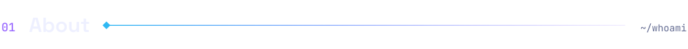
</picture>

I'm a fifth-year **Intelligent Systems & Computer Engineering** student at **Al-Aqsa University** in Gaza, Palestine. I work where machine learning meets real data: training CNNs on medical images, building predictive models on business data, and turning messy datasets into clear, usable insight.

- **Building** — *Tilqaa*, my graduation project: a platform for job and training opportunities. I'm the Team Lead and own the AI and data-analysis side; the team builds it with Flutter, Laravel, FastAPI and web scraping.
- **Community** — Events & Operations Team Lead at **GDG on Campus – Al-Aqsa University**.
- **Focus** — machine learning, deep learning, data analysis and Flutter.
- **Exploring** — IoT, embedded systems, robotics, cyber security and wireless communications.
- **Open to** — AI/ML internships, research collaborations and learning opportunities.

 

<picture>
  <source media="(prefers-color-scheme: dark)" srcset="assets/sections/02-toolkit-dark.svg" />
  <source media="(prefers-color-scheme: light)" srcset="assets/sections/02-toolkit-light.svg" />
  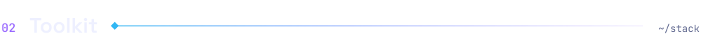
</picture>

  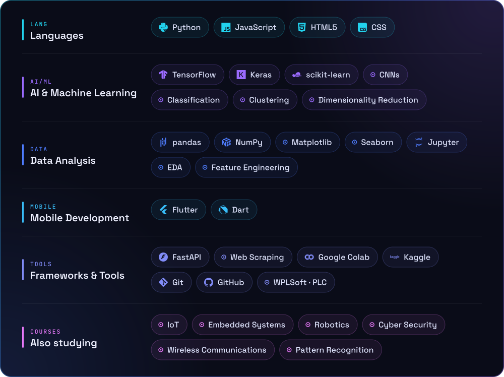

 

<picture>
  <source media="(prefers-color-scheme: dark)" srcset="assets/sections/03-featured-dark.svg" />
  <source media="(prefers-color-scheme: light)" srcset="assets/sections/03-featured-light.svg" />
  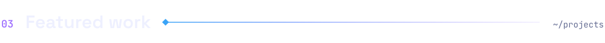
</picture>

  <a href="https://github.com/Mohammed-Algoul/lung-cancer-detection-deep-learning">
    
  </a>

  <a href="https://github.com/Mohammed-Algoul/Customer-Churn-Prediction">
    
  </a>

  <a href="https://github.com/Mohammed-Algoul/ML-Customer-Personality-Analysis">
    
  </a>

  <a href="https://github.com/Mohammed-Algoul/Ai-research">
    
  </a>

  
    More on GitHub:
    <a href="https://github.com/Mohammed-Algoul/University-Projects">University Projects</a> (PLC traffic-light and water-tank control)
    &nbsp;·&nbsp;
    <a href="https://github.com/Mohammed-Algoul/house-prices-preprocessing">House Prices preprocessing</a>
    &nbsp;·&nbsp;
    <a href="https://github.com/Mohammed-Algoul?tab=repositories">All repositories</a>
  

 

<picture>
  <source media="(prefers-color-scheme: dark)" srcset="assets/sections/04-github-dark.svg" />
  <source media="(prefers-color-scheme: light)" srcset="assets/sections/04-github-light.svg" />
  
</picture>

  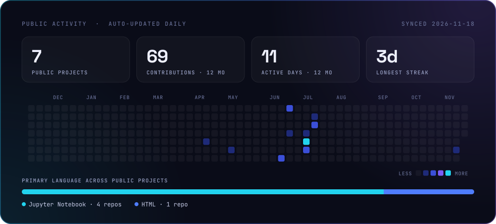

  Generated from the GitHub GraphQL API by a scheduled workflow in this repository. No third-party stats services.

 

<picture>
  <source media="(prefers-color-scheme: dark)" srcset="assets/sections/05-connect-dark.svg" />
  <source media="(prefers-color-scheme: light)" srcset="assets/sections/05-connect-light.svg" />
  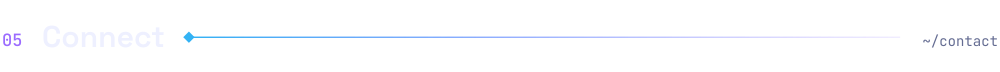
</picture>

  

  
  &nbsp;
  
  &nbsp;
  

 

  

